# MacTrack

A free, native macOS menu bar app that tracks which **apps** you use, which **websites** you spend time on, and **how productive** that time is. It can also **block** distracting apps and sites on a locked timer and **pause overnight**. No account, no subscription, no cloud: the database stays on your Mac.

<p align="center">
  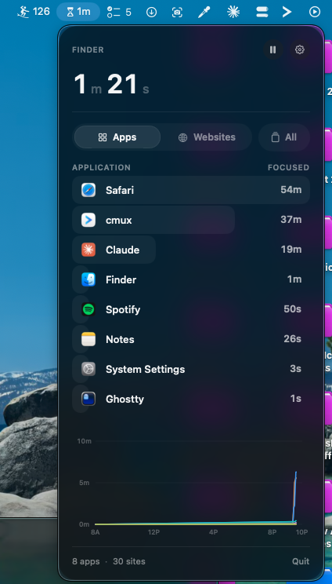
  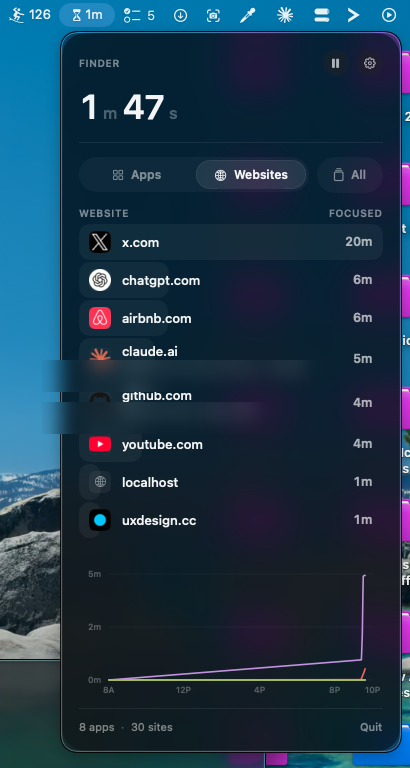
  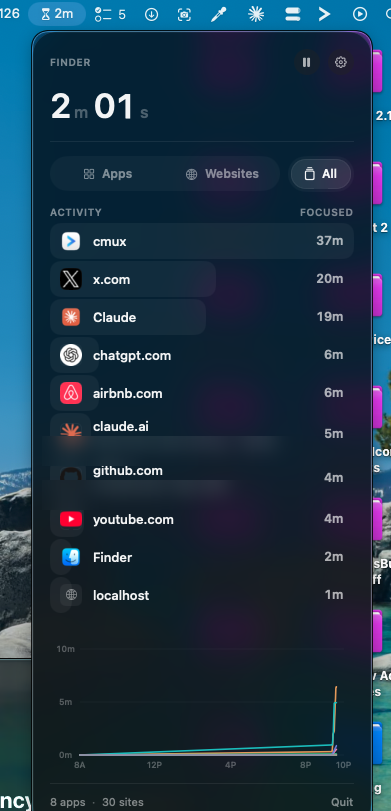
</p>

## What it does

- **Focused time only.** Time counts for the app in front of you. Background apps never inflate your totals.
- **Per-website time.** In a browser, time goes to the site's domain (`youtube.com`, `github.com`). Safari, Chrome, Edge, Brave, Arc, and Vivaldi.
- **Separate X accounts.** MacTrack reads the active X account from the page and gives each one its own row.
- **Idle and lock detection.** Tracking pauses when you go idle or lock the screen, so a coffee break never lands on whatever you left open.
- **Apps, Websites, and All.** Toggle between apps only, sites only, or one merged ranking by time. The merged view drops the browser app so its sites stand on their own.
- **Daily line chart.** Top items plotted across your day in each app or site's brand color, with a hover scrubber for exact values. It spans your real active window, first activity to last.
- **Total active time.** The productivity overview headlines your total active time on the Mac, measured from your first move. The home list keeps a live readout of what you're on right now at the top.
- **Row detail.** Click an app or site for a bar chart of when the time went, by hour, week, or month.
- **Reset time.** Opened something by mistake? Drill into a donut slice, right-click the item → **Reset time**, and it zeroes for the day. It re-accumulates if you go back.
- **Menu bar readout.** Live time for whatever you are on. Open the popover for the full breakdown.
- **Right-click to ignore.** Right-click any row and choose "Don't track." It disappears and stays gone.
- **Productivity score.** Tag any app or site productive or unproductive (right-click → **Productivity**) and your day rolls into a Productive / Unproductive / Other donut.
- **Projects.** Right-click a row → **Project** to say what you're working on; the tag button in the header shows per-project totals for today, this week, or this month, plus the apps and sites inside each one.
- **Day-by-day history.** A GitHub-style activity grid colors each past day by what dominated it. Click a day to rewind the popover to it.
- **Best-days leaderboard.** A trophy button ranks the days you spent the **least** time on unproductive things.
- **Blocking.** Right-click anything and block it for 15 minutes to 2 hours. A live block has no off switch, and an optional system-level filter keeps enforcing it even when MacTrack isn't running.
- **Block one X account, keep the other.** Block your doomscroll account and MacTrack auto-switches you to the allowed one when the blocked account is active.
- **Pause sleeps the display.** Pause stops tracking and sleeps the display. The first mouse move wakes the screen and resumes tracking.
- **Good-night mode.** One tap stops tracking for the night and resumes at the wake time you set.
- **Focus Guard.** Linger too long on something tagged unproductive and MacTrack frosts the screen with a quote until you switch away.

## Focus & productivity

Right-click any app or website and mark it **Productive** or **Unproductive**. The pie-chart toggle in the header flips the popover to a productivity overview: one donut splitting your day into Productive / Unproductive / Other, with the productive share in the middle. Untagged time is Other.

A browser is judged only by the **sites** you visit, never as an app. New or empty tabs, internal pages, and search-results pages (Google, DuckDuckGo, Bing, …) are left out of the split, so they can't inflate Other. That time still counts toward your total.

<p align="center">
  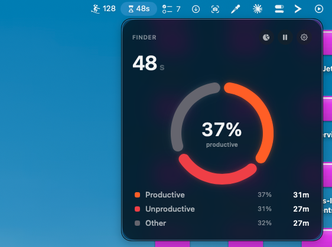
  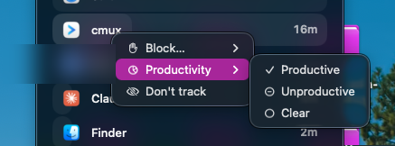
</p>

### Projects

A productivity tag says what *kind* of time it was; a project says *what you were working on*. Right-click any app or site → **Project** to make it the active project. The active project shows under the header's big readout and as a colored dot in the menu bar.

Choose **Always use for this app** (or **this site**) in the same menu to remember the association: the next time that app gains focus, the active project switches to its project. Items without a rule leave the active project alone.

The tag button in the header opens the projects page: per-project time for today, this week, or this month, an **Unassigned** row for time with no project, the apps and sites inside each project, the auto-switch rules, and an archived list. Time is credited second by second to whatever project is active, so renaming, archiving, or switching projects never relabels a past day.

### Your history, day by day

Below the donut, a GitHub-style **activity grid** of squircles colors each past day by the category that took the most time: Productive (amber), Unproductive (red), or Other (gray), each with a soft matching glow. Today stays neutral gray until the day is over, and later days in the week aren't drawn yet.

Click a day's square and the whole popover rewinds: donut, split, ranked list, and chart animate to that day, and the header shows the date and total with a **Today** button to jump back.

<p align="center">
  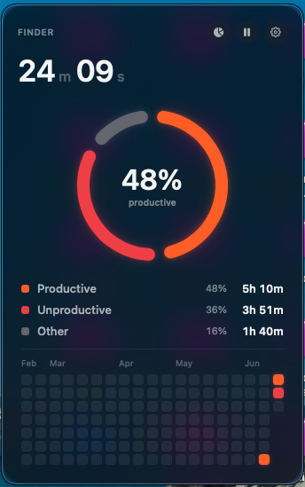
</p>

### Best days

A **trophy button** next to the pie-chart button ranks your top three days by the *least* time spent on unproductive apps and sites, showing the amount rather than the date. Only completed days you actually used count, so a quiet day you barely touched the Mac can't sneak to the top, and neither can today.

### Drill into any app or site

Click any row for a bar chart of exactly when the time went, with a **Day / Week / Month** toggle: minute-by-hour across the day, or per-day totals across the week or month. It's drawn in the app or site's **own brand color**, pulled from its icon or favicon (Safari's blue, YouTube's red). The header shows **% of today**, **% of the week**, or **% of the month** to match.

<p align="center">
  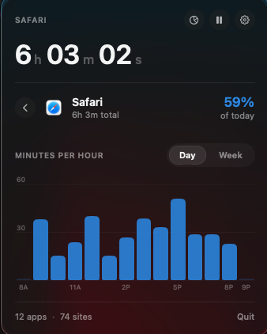
  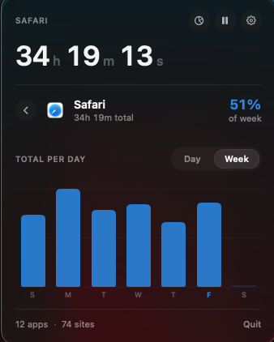
</p>

### X accounts, tracked separately

Signed into more than one X account? MacTrack reads the **active** account from the page and tracks each one on its own row. A slider switches between accounts or shows the combined **All** total, and you can tag each separately. Because all X accounts share one URL, this needs **"Allow JavaScript from Apple Events"** turned on in your browser's Develop menu. (Account names blurred below.)

<p align="center">
  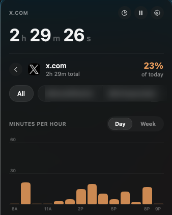
</p>

## Blocking

Right-click any app or site, choose **Block**, and pick 15 minutes to 2 hours. A locked countdown appears in the popover with no cancel button. While it runs, MacTrack hides the blocked app and bounces blocked tabs. The block survives quitting and relaunching, and moving your clock forward can't skip it.

<p align="center">
  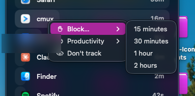
</p>

Force-quitting MacTrack gets around that app-side layer. For a system-wide block, a signed **Network Extension** content filter is DoH-proof and enforced by macOS itself even when MacTrack isn't running. It needs your own Apple Developer signing, so it ships as code plus a step-by-step guide: **[SETUP_BLOCKING.md](SETUP_BLOCKING.md)**.

**Block from settings, no visit required.** You can't right-click a site you haven't opened today, so **Settings → Blocking** has a picker of your recent sites and a search box for any site you've been on, or a brand-new domain you type.

**Per-account X blocking.** Both X accounts share `x.com`, so a domain block can't tell them apart. MacTrack reads the *active* account and blocks only the one you chose, driving X's account switcher to **route you onto your allowed account** and bouncing the tab only if there's nowhere to switch to. This is app-side and needs the same "Allow JavaScript from Apple Events" toggle.

## Focus Guard

Blocking is the hard stop. Focus Guard is the gentle one. Once you've spent an unbroken stretch on anything tagged **unproductive**, MacTrack frosts the entire screen and shows a single quote, centred, in a serif card that reveals itself one word at a time. The threshold is yours, from 5 minutes to an hour. The blur lifts the instant you switch to something else, and the way back to work sits at the bottom of the screen, appearing only after you stop and click once.

Pick the collections in settings: Stoic discipline (Seneca, Epictetus, Marcus Aurelius), leaders and conquerors (Caesar, Napoleon, Sun Tzu), business and money, daily motivation, Naval Ravikant, and more. The card is set in Newsreader with the author on an italic signoff line.

<p align="center">
  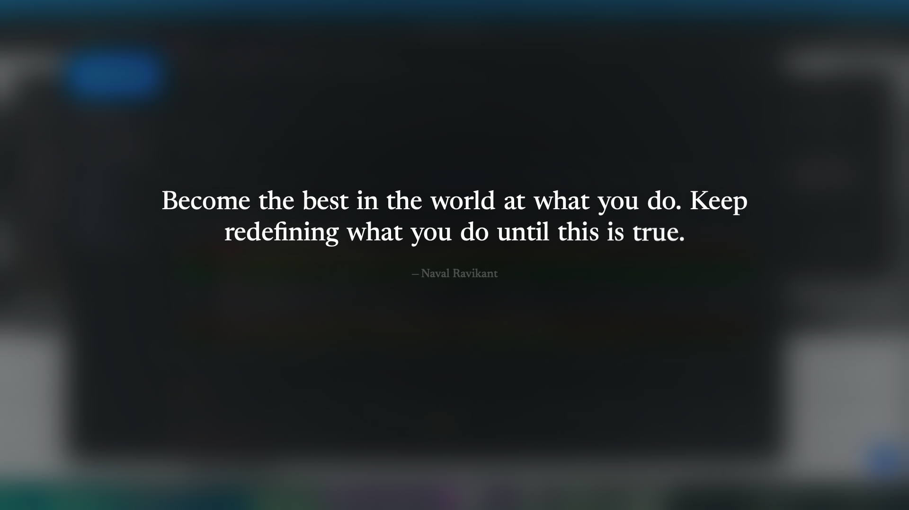
</p>

## Privacy

- **Local-first.** Your history lives in a SQLite database at `~/Library/Application Support/MacTrack/`. Nothing is uploaded anywhere.
- **Domains only.** MacTrack records the domain and how long you were on it, never page titles or what you were doing.
- **One network call.** The only thing fetched from the internet is website favicons, cached after first use.

## Requirements

- macOS 26 or later
- Xcode 26 or later (to build)

## Build and run

The Xcode project is generated from `project.yml` with [XcodeGen](https://github.com/yonaskolb/XcodeGen).

```bash
brew install xcodegen        # once
git clone https://github.com/Entrepenulian/MacTrack.git
cd MacTrack
xcodegen generate            # creates MacTrack.xcodeproj
open MacTrack.xcodeproj       # build & run with ⌘R
```

Or build from the command line:

```bash
xcodebuild -project MacTrack.xcodeproj -scheme MacTrack -configuration Release build
```

Launch at login can be turned on in settings.

## Permissions

To measure per-website time, MacTrack reads the active tab's address through macOS **Automation** (Apple Events). The first time it reads a browser, macOS asks for permission. Allow it, or website time won't be recorded. Change it later in **System Settings → Privacy & Security → Automation**, or from the gear in MacTrack.

## Settings

Settings opens from the gear in the popover, to a home that groups controls into categories so no screen runs off the bottom:

- **General** launch at login and the idle timeout
- **Good Night** your wake time
- **Focus Guard** switch it on, set the threshold, tick the quote collections, and Test the blur
- **Chart** the start and end hour of the daily chart
- **Website Tracking** the Automation permission, plus the list of anything you hid with "Don't track" so you can turn it back on
- **Blocking** the system-level filter toggle plus the website picker: your recent sites, each blockable on the spot, and a search box for any site you've visited or a new domain

<p align="center">
  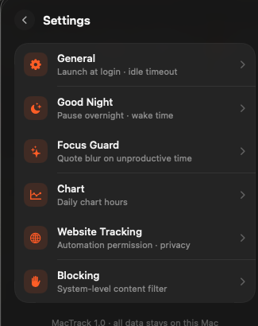
</p>

## How it works

A once-a-second sampler measures the real elapsed time between ticks and credits it to whatever is in focus: the frontmost app, plus the active tab's domain if that app is a browser. Large gaps (sleep, wake) are dropped and idle or locked time is skipped, so the first and last credited minute of a day mark when you actually started and stopped. That's where the chart's active window and your total time come from. New or empty tabs and search-results pages are credited to no site, so they stay out of the productivity split but still count toward the total. Totals roll up per day, and a per-minute series powers the chart. Writes are incremental and crash-safe (SQLite WAL), with daily backups and automatic restore.

## Tech

Swift, SwiftUI, and AppKit. SQLite via the system library, no third-party dependencies. `MenuBarExtra` for the menu bar surface, Apple Events for browser URLs, `SMAppService` for launch at login. Focus Guard's blur is a non-activating `NSPanel` at `CGShieldingWindowLevel()` with a native `NSVisualEffectView`, so it covers the menu bar and fullscreen apps without stealing focus.

```
MacTrack/
  App/        entry point and lifecycle
  Models/     usage records, categories, productivity tags, projects, chart data, quote bank
  Services/   sampler, browser reader, idle detector, blocks, system-extension control,
              store, database, icons, Focus Guard + blur overlay
  Design/     theme tokens, glass, formatters, bundled-font loader
  Resources/  app entitlements, bundled fonts
  Views/      popover, header, list, chart, productivity donut, projects, settings
NetworkFilter/  the system-level content-filter extension (see SETUP_BLOCKING.md)
```

The quote card is set in **Newsreader** and **Inter**, bundled as variable fonts under the SIL Open Font License (see `MacTrack/Resources/Fonts/OFL.txt`).

## License

MIT. See [LICENSE](LICENSE).
